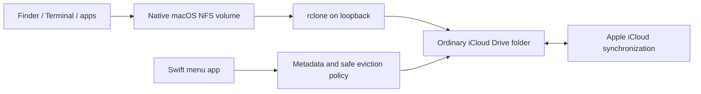

# iCloud Archive

**Browse everything. Keep file contents on your Mac only while you use them.**

iCloud Archive is a native macOS menu bar app that presents a dedicated Finder
disk backed by an ordinary folder in iCloud Drive. File names, logical sizes,
dates and folders stay visible after the local contents have been evicted.
Opening a file lets macOS download it. After **24 hours without content use**
(configurable), the app requests removal of the local copy once it is safe.

The file in iCloud is retained. This uses your normal iCloud storage allowance.
There is no S3 interface, photo encoding, proprietary archive format, Apple
password prompt, or kernel extension.

> **Status: early release (0.1).** The inactivity policy and native iCloud
> round trip are tested, but this is not an Apple product or a backup service.
> The Finder volume uses rclone's experimental native NFS mount. Keep independent
> backups of irreplaceable data, as you would with any synchronized folder.

> **Local space is required during imports.** This version uses the local iCloud
> Drive folder as its backing store. Copying 30 GB into the disk creates local
> backing files and can also require substantial write-staging space, in addition
> to any source files already on this Mac. Upload must finish before local
> eviction is safe; automatic eviction normally also waits for the configured
> inactivity interval. This is **not a direct-to-cloud uploader** and does not
> enforce a hard limit on local disk use. Cloud-only metadata browsing works
> after eviction, but it does not remove the initial import-space requirement.

For the stricter requirement of bounded import space while ordinary iCloud Drive
stays enabled, see the [cloud-only storage investigation](docs/CLOUD-ONLY-DESIGN.md).
It explains why folder exclusion does not solve this and proposes a separate
CloudKit archive. **That replacement is not implemented** and would change
compatibility with ordinary iCloud Drive files and iPhone access.

## What you get

- A disk named **iCloud Archive**, available in Finder and at `~/iCloud Archive`.
- A menu bar app with a metadata-only file browser, cloud status, logical size,
  and locally allocated bytes.
- On-demand content access through Finder, Terminal, or ordinary applications.
- Automatic local eviction after 24 hours; 1, 6, 24, 72, or 168 hours in Settings.
- Manual **Download** and **Free local space** actions.
- Native login-item support and optional automatic mounting at launch.
- English and Italian UI; English documentation and diagnostics.
- A JSON-capable CLI and explicit guidance for AI coding agents.

## Requirements

- macOS 14 or later, with iCloud Drive enabled and enough iCloud storage.
- Swift 6 / Xcode Command Line Tools to build from source.
- [rclone](https://rclone.org/) 1.75.1 is the tested helper version.
- Apple Silicon is tested locally. The source can build on Intel; Intel is not
  yet covered by the local verification record.

The default backing folder is **iCloud Drive / iCloud Archive**. Existing iCloud
files elsewhere are not migrated, scanned, or evicted by this app.

## Build and install

```sh
xcode-select --install                    # if Command Line Tools are missing
brew install rclone
git clone https://github.com/magno73/icloud-archive.git
cd icloud-archive
swift test --disable-xctest
./scripts/build-app.sh --install --launch
```

The script creates `dist/iCloud Archive.app`, embeds your installed rclone with
its license, and installs the app into `~/Applications`. It refuses to replace
a running app. It never downloads a helper or changes system security settings.

Local builds are **ad-hoc signed**, not Developer ID signed or notarized. Building
locally is the supported installation path for this release. For distribution,
maintainers must supply their own `SIGNING_IDENTITY` and notarization process.
Do not disable Gatekeeper globally.

Open Settings and enable **Open at login** to keep the utility available after a
restart. The menu bar app continues running when its main window is closed.
On first launch, macOS may ask to allow access to **iCloud Drive**. Approve that
request to access your archive. The app waits for this consent before mounting.

## Use the archive

1. Open the app and choose **Show disk in Finder**.
2. Copy files into the mounted disk. macOS then uploads the backing files to
   iCloud Drive. A successful Finder copy can precede that cloud upload.
3. Wait for **On Mac + iCloud** status. Until upload is confirmed, local data is
   protected from eviction.
4. After the inactivity interval, the app requests local eviction. You can also
   select files in the app and use **Free local space** immediately.
5. Names, dates and logical sizes remain. Open a file to download/use it again.

For direct access, choose **File > Add to Sidebar** while the archive window is
open in Finder. macOS may otherwise group this local NFS volume under `localhost`.

```sh
ls -lh "$HOME/iCloud Archive"             # metadata only
stat "$HOME/iCloud Archive/video.mov"    # metadata only
open "$HOME/iCloud Archive/video.mov"    # reads content; can download
```

**Finder previews are content access.** The app's Finder button requests List
view with icon previews disabled for the archive window. Allow Finder automation
when macOS asks, or configure it yourself. Use List view, turn off **Show icon
preview** in View Options, and hide the Preview pane when browsing without
downloads. Quick Look, thumbnail generators, media analyzers, checksums,
`file`, and backup/indexing tools may read content and hydrate a file. A
filesystem cannot distinguish a deliberate open from another program's read.
Embedded metadata such as video duration, EXIF, or codecs can also require
content; the metadata-only guarantee covers filesystem attributes.

**Free local space is not Delete.** Deleting a file from this disk deletes the
ordinary iCloud Drive file, including on other synchronized devices. The app's
eviction actions never delete the cloud object. Normal Finder copies also keep
their original source file elsewhere; the app never silently removes that source.

## Inactivity and safety

The app checks every five minutes while running. The timer tracks filesystem
content access/modification times, explicit download requests and transitions
from cloud-only to local. Simply listing or refreshing metadata does not reset
it. Newly discovered files receive a full grace period, even if their dates are
old. A lost/corrupt journal also gives a new grace period.

A file is eligible only when all of these conditions are confirmed:

- It is a regular file inside this archive, with no symlink escape.
- iCloud confirms an uploaded copy, no upload/download in progress, no conflict
  and no synchronization error. Missing resource keys block eviction.
- No source or mounted file handle is open. A failed `lsof` check blocks eviction.
- The bridge has no outstanding or cached writes.
- Its inactivity interval has elapsed (except for the explicit manual action).

The policy rechecks metadata immediately before calling Apple's
[`evictUbiquitousItem`](https://developer.apple.com/documentation/foundation/filemanager/evictubiquitousitem(at:)).
Removal is asynchronous and best-effort: macOS may defer it. “Removal requested”
is not a claim that all system caches or APFS snapshots have been reclaimed.

Reads do not create an additional rclone disk cache. Writes use a durable staging
cache for normal editor behavior. Clean staging files expire shortly after
write-back; pending/failed writes are retained. Never delete `WriteCache` to
recover disk space. Large imports can temporarily need space for both staging
and the backing iCloud file. Files above Apple's documented **50 GB** per-file
limit are outside this version's scope.

## CLI and AI agents

After building, `swift build --show-bin-path` prints the binary directory. The
installed CLI is also at:

```text
~/Applications/iCloud Archive.app/Contents/MacOS/icloud-archive
```

```sh
icloud-archive list --json
icloud-archive status 'project/video.mov' --json
icloud-archive download 'project/video.mov'
icloud-archive evict 'project/video.mov'           # preview only
icloud-archive evict 'project/video.mov' --apply   # safe native local eviction
icloud-archive prune --idle-hours 24               # preview eligible files
icloud-archive prune --idle-hours 24 --apply
icloud-archive mount                              # foreground; Ctrl-C to eject
```

Paths are relative to the archive; `--root PATH` overrides its location. The
CLI has no delete command. Quit the GUI before headless mutations: an exclusive
ownership lock protects the cache and journal. Read-only inspection remains
available while the GUI is running. Unknown options fail rather than being
interpreted as filenames. Dates in JSON output are ISO 8601.

For a managed local installation, launching the app with `--enable-login-item`
requests native login-item registration. It is also controllable in Settings.

AI agents should start with [AGENTS.md](AGENTS.md), then read
[ARCHITECTURE.md](docs/ARCHITECTURE.md) and [VERIFICATION.md](docs/VERIFICATION.md).
Never infer that a successful local copy is a completed iCloud upload, or that
a logical file size is locally allocated storage.

## Architecture and privacy



The Swift app uses Apple's native iCloud APIs; rclone only serves the local
folder. No Apple credentials enter this app or rclone. There is no analytics,
web service, or external control endpoint. The helper listens on IPv4 loopback;
its control API has a random per-session password. The NFS data endpoint is a
local convenience transport, **not a security boundary against other local
accounts/processes**. Use this early release on a trusted personal Mac.

The Swift package has no third-party package dependencies. The bundled rclone
helper is MIT licensed; see [third-party notices](Resources/THIRD-PARTY-NOTICES.txt).

## Development

```sh
swift test --disable-xctest
./scripts/smoke-mount.sh
./scripts/build-app.sh
```

Tests use Swift Testing, so full Xcode/XCTest is not required. The smoke test
mounts disposable local data and never accesses iCloud. Native UI and real
iCloud tests require an interactive signed-in Mac; they do not run in CI.
See [CONTRIBUTING.md](CONTRIBUTING.md) for code and review conventions.

## Known limitations

- This is an NFS network filesystem, not a File Provider domain or block device.
  Some applications require stronger local filesystem semantics. Edit a local
  copy for software that does not support network volumes.
- Some clients request NFS exclusive creation, which the helper does not support.
  The tested macOS client retried successfully, but creating a file this way can
  pause before completing.
- Keep files closed before expecting automatic release. Filesystem access times
  can be affected by other readers; this can delay eviction. Content reads
  satisfied from the kernel cache may not cause a fresh backing-file access;
  the open-handle guard still protects ongoing use.
- Cleanup pauses when the app is closed, the Mac sleeps, the write cache is
  unsettled, or iCloud's state is unknown. It resumes after the app wakes/runs.
- Hidden control files and package contents are excluded from automatic sweeps.
  There is currently a 100,000-file sweep limit.
- Metadata listings can be cached for up to five seconds by the bridge.
- Never force-unmount during writes. After a crash, eject a stale volume and
  reopen the app so the helper can replay its staging cache. Do not discard it.
- No shared-album loopholes, chunking above 50 GB, version history, Windows/Linux
  UI, or standalone cloud backup guarantees are provided.

## License

[MIT](LICENSE). iCloud is a trademark of Apple Inc. This project is independent
and is not affiliated with Apple. Its storage format is simply your files.
