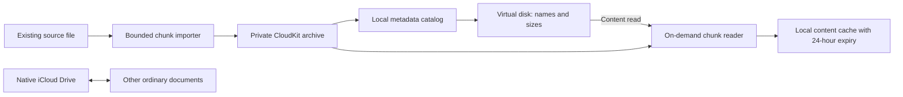

# Cloud-only storage: investigation and proposed replacement

Status: **superseded; CloudKit approach rejected, not implemented**. See the
[direct archive design](DIRECT-ARCHIVE-DESIGN.md) for the revised recommendation
without developer provisioning and with isolation from other devices' accounts.
The remaining text records the earlier technical investigation, not the current
product direction. Reviewed on 2026-11-01. Version 0.1 still
uses a local iCloud Drive backing directory and requires local import space.
Its successful eviction tests do not validate the architecture proposed here.

## Requirement and conclusion

The archive must show names, sizes and filesystem metadata without downloading
content, retain native iCloud Drive for unrelated documents, and avoid making a
second full local copy merely to import a large file. Downloaded content should
expire after 24 hours without use, with open files and uncommitted writes protected.

No supported per-folder iCloud Drive setting was found that means “keep this
folder on the server, but never let native sync download its content.” Excluding
an item from sync has the opposite meaning. A direct uploader alone cannot impose
a cache policy on Apple's independent iCloud Drive service.

The earlier recommendation was an **app-managed CloudKit private database**,
with a separate virtual filesystem and bounded transfer/cache storage. This
changes an earlier product requirement: the archive would no longer consist of
ordinary iCloud Drive files. That tradeoff needs agreement before implementation
or migration. Native iCloud Drive can remain enabled for other documents.

## Why folder exclusion is not the solution

Apple describes `ubiquitousItemIsExcludedFromSync` as an item present locally but
absent from the server. Its archived iCloud guide likewise describes `.nosync`
as preventing upload. Neither is a cloud-only policy; do not apply either as a
space-saving workaround to existing cloud data.

Sources: [Foundation exclusion property][excluded], [iCloud design guide][nosync].

“Remove Download” removes a local copy while retaining the cloud file. “Optimize
Mac Storage” allows macOS to manage downloaded content. Neither documents an
absolute prohibition on later downloads for one folder. Previewing or otherwise
reading a placeholder may download it again. [Apple's storage guidance][storage]

File Provider exposes content policies for items managed by a provider. This is
useful when building our own provider; it does not grant our app control over
Apple's iCloud Drive provider. [File Provider content policies][content-policy]

## Options considered

| Approach | Ordinary iCloud Drive files | Native Drive stays enabled | Controls archive download requests | Full local import copy |
| --- | --- | --- | --- | --- |
| Current native-folder bridge | Yes | Yes | No; macOS owns hydration | Required, with additional write staging possible |
| Direct Drive uploader and separate mount | Yes | Yes | Only its own client, not native Drive | Direct imports can avoid our full staging copy; native downloads remain possible |
| Direct Drive client with native Drive disabled | Yes, remotely | No | Its own client | Potentially avoidable with a dedicated importer |
| Proposed CloudKit archive | No | Yes | Our app controls asset requests | Designed to avoid it; bounded staging must be measured |

The direct-Drive option is real, but weaker than the requirement. Rclone supports
Apple password/2FA authentication and documents periodic reauthentication. It
does not configure selective native-sync exclusion. [Backend documentation][rclone]

Source inspection of rclone **v1.75.1** shows a known-size reader passed to the
upload request. It also shows the existing destination moved to trash before a
replacement upload succeeds. A future adapter must not treat that overwrite
path as a crash-safe archive commit; use new versions and commit metadata only
after successful upload. This is source inspection, not a live large-file upload
test. Sources: [`Object.Update`][rclone-object], [`DriveService.Upload`][rclone-upload].

## Proposed CloudKit design

Use the native CloudKit framework in Swift. Rewriting the UI in Rust would not
remove the storage constraints; network and disk I/O dominate these operations.

CloudKit private data consumes the user's existing iCloud storage allowance.
CloudKit databases are app-specific server containers, distinct from iCloud
Documents' local synchronized directories. We would use explicit CloudKit
operations, not automatic mirroring of every asset. Sources: [private database][quota],
[configuring iCloud services][configuration].

### Metadata and reads

- Store stable IDs, parent IDs, names, logical sizes, dates and version references
  separately from content. Keep a small local catalog for offline enumeration.
- Store immutable content chunks and a versioned manifest. Listing and `stat`
  must never fetch asset fields. Restrict every metadata fetch/change operation
  to metadata fields; CloudKit otherwise downloads assets with their records.
  [CKAsset documentation][assets]
- Fetch chunks only on content reads, verify their hashes, and cache locally.
  A 30 GB logical file can therefore be listed without allocating 30 GB locally.
  Reading the entire file may require substantial local space; explicit full
  downloads must check capacity and show the required size before starting.
- Track reads/open sessions in the filesystem layer. Metadata access does not
  refresh the idle timer. After 24 hours, reclaim only committed, unused local
  cache entries. Never delete CloudKit records to free local space.
- Quick Look, thumbnails and indexers are also content readers. A virtual disk
  cannot generally infer human intent from a read. Preserve the preview caveat
  and test indexing behavior; do not promise “only a deliberate double-click.”

### Imports and writes

Provide an **Import** action and CLI that read the existing source file directly,
including a file on an external disk. Start with 64 MiB chunks and bounded
concurrency as an experimental configuration, not a published disk-space bound.
Upload a chunk, persist acknowledgement, then reclaim its disposable staging
file. Retain the source unchanged until the complete manifest is committed.
Detect source mutation and fail safely. Never delete the user's source implicitly.

Publish a new file/version only after all required chunks are acknowledged;
make manifest updates conditional to detect concurrent changes. Keep an earlier
version reachable until replacement succeeds. Persist resumable progress and
make retries idempotent. Remote orphan cleanup is a separate, conservative
operation, never part of local eviction.

This addresses a 30 GB import without intentionally making another 30 GB backing
file. It does not make an already-local 30 GB source disappear. Apple's SDK may
use additional temporary storage; actual total allocation must be measured.
Passing a full source URL to `CKAsset` alone is not evidence of a bounded import.
[Asset initializer][asset-init]

An arbitrary Finder copy or editor can issue random writes and may not supply a
reliable final size. Do not silently retain the current unlimited write staging.
The first prototype should expose archive content read-only and provide explicit
Import/Export. General writable-volume support is a separate milestone requiring
an enforced staging budget, crash recovery, and a clear out-of-space failure.
This is another visible behavior change from version 0.1.

Native `CKAsset` supports large assets according to an Apple engineer, but chunking
here is for bounded working space, retries and range reads, not a claim that
CloudKit has a 50 MB native-file limit. [Apple's size-limit clarification][limits]

### Compatibility and distribution

- The Finder/Terminal disk remains a product requirement, but its backend must
  change. Serving the existing local iCloud folder with rclone is insufficient.
- Content will not appear as ordinary files in iCloud Drive or its web interface.
  iPhone access requires a companion app; integration with Files requires an iOS
  File Provider extension. Neither exists in this repository today.
- CloudKit requires a registered container, the relevant entitlements and valid
  provisioning/signing. The present ad-hoc build is not sufficient. A maintainer
  needs the appropriate Apple developer setup; users of a distributed signed app
  do not each need their own developer membership. [iCloud configuration][configuration]
- Independent builders must address container ownership and access. Publish the
  manifest format and an ordinary-file export path so the archive is recoverable
  through a properly authorized build. An open-source license by itself does not
  grant another developer's signing team access to a CloudKit container.
- Do not migrate the existing native archive automatically. Export/import and
  verification must precede any separately authorized removal of old cloud files.

## Evidence required before claiming the problem is fixed

1. Provision a signed test app/container and perform an actual CloudKit round trip.
2. Import a synthetic 30 GB file from an external source while recording total
   local allocation, including SDK/system temporary space. Test a low-free-space
   condition; enforce the chosen budget or stop safely before exhausting storage.
3. Leave native iCloud Drive enabled and verify that metadata refreshes, Finder
   listing, Terminal `stat`, relaunch and remote updates fetch no archive assets.
4. Open/read/seek a large file and verify content hashes and measured cache use.
5. Test idle eviction, long open sessions, pending writes, interrupted uploads,
   quota exhaustion, account changes and concurrent version changes.
6. Demonstrate export/recovery with no data loss. Document exactly which paths
   support imports versus arbitrary Finder/editor writes.

Completed research: Apple documentation/SDK review and rclone source inspection.
Not completed: a provisioned CloudKit backend, new filesystem implementation,
large-file storage measurements, or migration. No user data or sync settings
were changed during this investigation.

[excluded]: https://developer.apple.com/documentation/foundation/urlresourcevalues/ubiquitousitemisexcludedfromsync
[nosync]: https://developer.apple.com/library/archive/documentation/General/Conceptual/iCloudDesignGuide/Chapters/iCloudFundametals.html
[storage]: https://support.apple.com/en-gb/guide/mac-help/-mchl1a02d711/mac
[content-policy]: https://developer.apple.com/documentation/fileprovider/nsfileprovidercontentpolicy
[rclone]: https://rclone.org/iclouddrive/
[rclone-object]: https://github.com/rclone/rclone/blob/v1.75.1/backend/iclouddrive/iclouddrive.go#L924
[rclone-upload]: https://github.com/rclone/rclone/blob/v1.75.1/backend/iclouddrive/api/drive.go#L530
[quota]: https://developer.apple.com/documentation/cloudkit/ckcontainer/privateclouddatabase
[configuration]: https://developer.apple.com/documentation/xcode/configuring-icloud-services
[assets]: https://developer.apple.com/documentation/cloudkit/ckasset
[asset-init]: https://developer.apple.com/documentation/cloudkit/ckasset/init(fileurl:)
[limits]: https://developer.apple.com/forums/thread/827897
