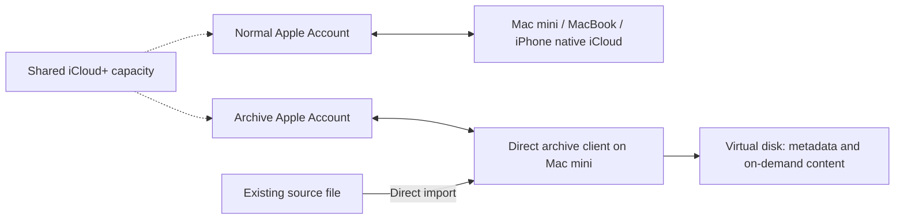

# Direct iCloud archive without CloudKit provisioning

Status: **researched proposal, not implemented or authenticated end to end**.
Reviewed on 2026-11-01. This supersedes the CloudKit recommendation, which was
rejected because the application must not depend on developer registration and
provisioning. Version 0.1 still uses its original native Drive backing folder.

## Requirement

Archive large videos from a Mac with limited free disk space, expose names and
sizes in Finder/Terminal, retrieve content on demand, and expire downloaded
content after 24 hours of inactivity. The archive must not propagate into the
user's other devices' ordinary iCloud Drive. No CloudKit app/container setup.

Three separate problems must not be conflated:

1. Upload without another full local copy of the source.
2. Control content caching on the archive client.
3. Keep the archive outside the native sync account used on other devices.

A direct uploader addresses the first; a virtual filesystem addresses the
second. Neither changes Apple's sync policy for other devices on the same
account. Metadata synchronization also does not necessarily mean that every
device downloads every file's full content. [Apple's download controls][downloads]

## Recommended account boundary

Use a **separate Apple Account dedicated to the archive**, authenticated in the
direct client. Keep the normal Apple Account in the devices' iCloud settings.
Do not enable native iCloud Drive for the archive account or share its archive
folder back to the normal account. Account isolation, rather than an unsupported
folder exclusion, prevents the normal devices' sync clients from accessing the
archive. This conclusion follows from the account and sharing boundaries Apple
documents; the complete client workflow still needs a live test.

Apple explicitly allows inviting one's additional Apple Accounts into a Family
Sharing group. [Family setup][family] A shared iCloud+ plan shares capacity while
keeping each account's documents private. [iCloud+ sharing][quota] Thus an existing
plan may cover the archive without a second storage subscription, provided the
group has an available member slot and sufficient capacity. A separate plan is
the fallback; do not assume the user's group or entitlement is already suitable.

A newly created web-only account has limited iCloud functionality/storage until
activated on an Apple device. Plan an initial setup using a separate macOS user
if needed, without replacing the user's everyday account. Native Drive for that
archive account must be disabled before populating the archive. This setup has
not been performed. [Apple's web-only account guidance][activation]

## Direct transport and app lifetime

Rclone already has an iCloud Drive backend. A normal locally built macOS app can
wrap that helper without CloudKit entitlements or a provisioning profile. The
existing local build mechanism can be retained; there is no need to register a
CloudKit container. Local app signing and Apple service authentication are
different concerns.

Rclone requires the account's regular password and 2FA, not an app-specific
password. Its documented trust token lasts 30 days and requires reauthentication.
This is not maintenance-free unattended storage: expose expired-login state and
an interactive reconnect flow. Do not collect passwords in chat. Web access must
be permitted; Advanced Data Protection may require approval from a trusted
device. The web-service integration can change independently of the app.
[Rclone iCloud backend][rclone]

## Uploads and large files

Use an explicit importer that opens the existing file and knows its size. Source
inspection of rclone v1.75.1 shows `io.Reader` passed through to the HTTP request,
without a mandatory whole-file staging copy in this path. Do not copy the source
into the mounted volume or the native iCloud directory first. Source and HTTP
implementation: [backend upload][upload], [REST transport][rest].

If the source is already on the internal disk, its original bytes still occupy
space until the user elects to remove them after verified upload. If the source
is on external storage, direct import need not deliberately create a full
internal copy. The actual maximum memory and temporary-disk consumption needs
measurement with representative files and interrupted transfers.

Apple documents a 50 GB per-file limit. [Drive status guidance][limit] For larger
files, evaluate rclone's chunker overlay: known-size inputs are split while
streaming and presented as one logical file through the client. Unknown-size
input can trigger a full temporary copy and must not be used for bounded-space
imports. Chunked files require the overlay or reconstruction on export; they are
not standalone videos in the underlying Drive folder. [Chunker documentation][chunker]

The raw iCloud backend's replacement path trashes the existing destination before
the upload completes. Use unique version destinations, verify the new upload,
then commit the catalog/version pointer. Never make the old version inaccessible
before the new one is safely committed. Remote deletion and source deletion are
separate operations from cache expiry. [Pinned backend implementation][update]

## Mount, cache and playback

The existing experimental loopback NFS bridge can be evaluated with a remote
source instead of a local native-Drive directory. Start with read-only access and
direct Import for additions. Unknown-size and random Finder writes need a
separate, explicitly budgeted staging design; enabling generic VFS write caching
would reintroduce the original disk-space problem.

Rclone can read directly from a remote with disk caching disabled. For a retained
24-hour cache, a naive `--vfs-cache-max-size` is only a soft target: open files and
the polling interval allow it to be exceeded. A hard budget therefore requires
additional admission control or a bounded chunk cache. Keep this as a tested
design requirement, not an advertised capability of the current implementation.
[VFS caching documentation][mount]

Metadata operations must not fetch payloads. Playback may read ranges without
downloading the whole video, subject to player/backend behavior; validate seeking
with actual applications. Downloading a complete 30 GB file still needs 30 GB at
the selected destination. Thumbnail generators and previewers can also read
content, and application-created caches are outside our filesystem's control.

## Validation and remaining decisions

- Confirm that a dedicated account is acceptable and whether shared capacity is
  available. Do not create accounts, change Family Sharing, or buy storage as a
  side effect of research.
- Authenticate that account and test listing/upload/read without native Drive.
- Measure a large direct import from external storage with little internal free
  space; verify checksums, interruption recovery and expired-token behavior.
- Check that the normal account on other devices receives no archive entries.
- Validate metadata-only enumeration, seeking and 24-hour eviction independently
  from the already-tested native-folder backend.
- Treat files above 50 GB and a retained read cache as explicit validation cases.

If a separate account is unacceptable, using the same ordinary iCloud Drive
account while requiring absolute archive exclusion on other native-sync devices
remains unsupported by the mechanisms reviewed. The alternatives are disabling
native Drive on those devices, accepting best-effort download optimization, or
using storage outside that native-sync account. Do not relabel optimization as
isolation.

[downloads]: https://support.apple.com/en-gb/guide/mac-help/-mchl1a02d711/mac
[family]: https://support.apple.com/en-ca/108380
[quota]: https://support.apple.com/en-gb/108783
[activation]: https://support.apple.com/en-gb/102447
[rclone]: https://rclone.org/iclouddrive/
[upload]: https://github.com/rclone/rclone/blob/v1.75.1/backend/iclouddrive/api/drive.go#L530
[rest]: https://github.com/rclone/rclone/blob/v1.75.1/lib/rest/rest.go#L334
[update]: https://github.com/rclone/rclone/blob/v1.75.1/backend/iclouddrive/iclouddrive.go#L924
[limit]: https://support.apple.com/en-nz/guide/mac-help/mchlc994344b/27/mac/27
[chunker]: https://rclone.org/chunker/
[mount]: https://rclone.org/commands/rclone_mount/#vfs-file-caching
